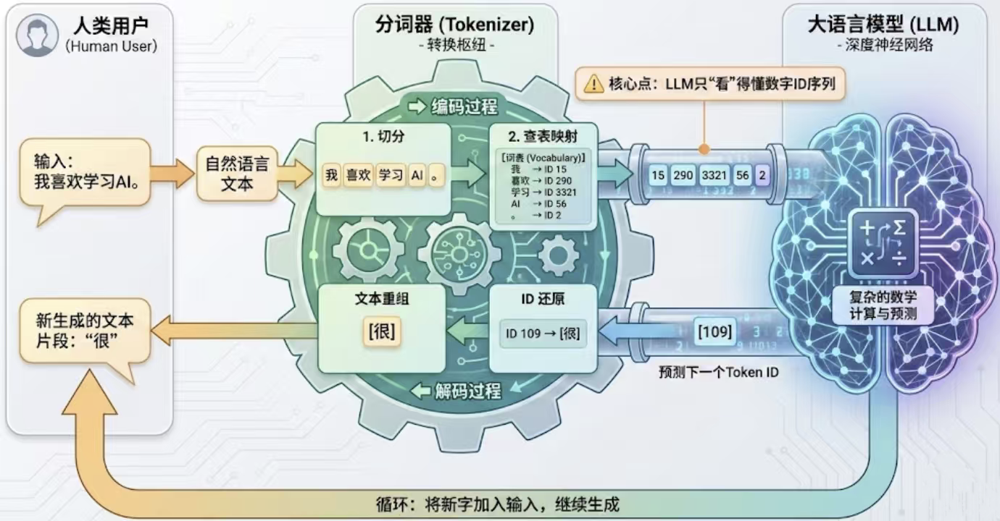

+++
title = "手搓 LLM 笔记 09：diy-llm 分支，从分词器开始"
date = 2026-10-27T12:00:00+08:00
draft = false
slug = "llm-09-diy-llm-tokenizer"
tags = ["LLM", "diy-llm", "BPE", "tokenizer", "学习笔记"]
summary = "手搓 LLM 开启第二条分支：从零构建大模型（已完结）之外，新增 diy-llm 理论线。M1 自训 BPE，先把分词器这张图看懂。"
[cover]
    image = "covers/llm-09-diy-llm-tokenizer.jpg"
    alt = "手搓 LLM 笔记 09：diy-llm 分支"
    hiddenInList = true
    hiddenInSingle = true
+++

> 手搓 LLM 系列从这篇起有两个分支：**从零构建大模型**（00-08，书已读完、代码已重写）和 **diy-llm**（CS336 中文本土化课程，理论线）。diy-llm 与 nanochat 作品线双轨并行，配套关系见 [lvchat 实现导图](/nanochat/lvchat-roadmap/) 和 [diy-llm 立项书](/diy-llm/diy-llm-proposal/)。

## M1 的目标

在 squid-llms 里自己训一个 BPE 分词器，不调用 tiktoken。验收两条：

1. 编解码往返无损（encode 再 decode，原文一字不差）
2. 压缩率可测（同样的语料，我的词表 vs GPT-2 词表，谁更省 token）

配套阅读：diy-llm 第 2 章（分词器）；标准答案：nanochat 的 tokenizer.py。

## 一张图看懂分词器的位置

这张图值得收藏，因为它把分词器放回了完整链路里，而不是孤立地讲算法：

- **编码 = 切分 + 查表映射**。文本先切成片段，再按词表（Vocabulary）映成 ID 序列。“我喜欢学习AI。” → `[15, 290, 3321, 56, 2]`。
- **模型只看得懂数字 ID 序列**。它不认识“我”也不认识“AI”，它看到的永远是 ID。词表就是人和模型之间的翻译官。
- **模型产出的是下一个 Token ID**，比如 `[109]`。
- **解码 = ID 还原 + 文本重组**。109 查表还原成“很”，再拼回文本。
- **循环：新字加入输入，继续生成**。这就是自回归——每一步都把上一步的输出接回输入。

## 已经想明白的三个点

**一、为什么自己训 BPE，而不是继续用 tiktoken。** GPT-2 的词表是为英文互联网配的，喂中文和代码会把很多字拆成多个 byte token，同样的文本 token 数翻倍，训练和推理都更贵。自己训，词表才为自己的语料服务，词表大小也成为自己的旋钮。

**二、训练的产物不是模型，是一张合并表。** BPE 训练就是反复统计“哪对相邻符号最频繁”，合并成新 token，记下轮次。有了合并表（mergeable_ranks），编码就是查表合并。nanochat 的做法印证了这个本质：训练用 rustbpe，推理把合并表交给 tiktoken——训练和编码是两个独立问题。

**三、编码最容易写错的地方是“按 rank 顺序应用合并”。** 后学的合并依赖先学的，顺序乱了，编解码往返就无损不了。M1 的坑大概率会踩在这。

## 接下来的动作

在 `squid/tokenizer/bpe.py` 里实现三个函数：`train_bpe`（学合并表）、`encode`（按表切分）、`decode`（还原）。先小语料跑通往返，再上博客语料测压缩率。踩坑记录会继续写进这篇或下一篇。
